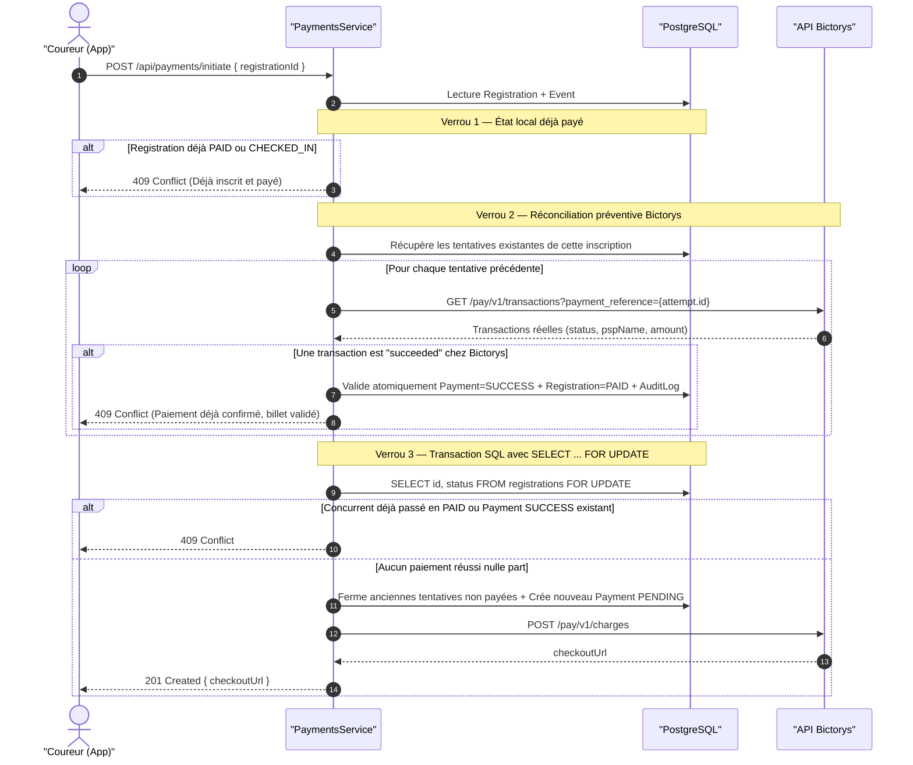

# 🛡️ Documentation & Plan Étape par Étape : Bloquer le Double Paiement d'une Inscription

> [!IMPORTANT]
> **Règle métier absolue** : Dès qu'un utilisateur est inscrit à un événement et a réglé son billet (que le webhook Bictorys soit déjà arrivé ou qu'il ait du retard), il ne doit **jamais** pouvoir initier un nouveau paiement (`POST /api/payments/initiate` et `POST /api/events/:id/register` doivent refuser avec **`409 Conflict`**).

---

## 1. Diagnostic : Pourquoi un 2ᵉ paiement a-t-il pu être lancé lors des tests ?

En inspectant simultanément la base PostgreSQL (Neon) et l'API Sandbox Bictorys sur des essais réels, nous avons identifié **3 causes combinées** :

### Cause n°1 — En local (`localhost:3000`), Bictorys ne peut pas livrer ses Webhooks
Lorsque l'utilisateur paie sur Bictorys, les serveurs de Bictorys essaient d'appeler l'URL de webhook configurée. Or `http://localhost:3000` n'existe que sur la machine locale du développeur : sans tunnel public (comme `ngrok` ou un serveur déployé), le backend ne reçoit jamais la notification automatique. En base de données, l'inscription reste donc à `status = 'pending'`.

### Cause n°2 — Le piège de l'API Bictorys : `chargeId` vs `payment_reference`
Lorsqu'on crée un paiement via [`src/payments/providers/bictorys.gateway.ts`](../src/payments/providers/bictorys.gateway.ts), `POST /pay/v1/charges` renvoie un `chargeId` (identifiant de session checkout).
- ❌ Appeler ensuite `GET /pay/v1/transactions/{chargeId}/status` renvoie `{"id": null, "status": "pending"}` **même quand le client a déjà payé !**
- ✅ En revanche, appeler `GET /pay/v1/transactions?payment_reference={payment.id}` renvoie le **tableau réel de toutes les tentatives** liées à notre `payment.id`, avec :
  - `"status": "succeeded"` (ou `"failed"` si une carte a échoué juste avant qu'Orange Money réussisse sur la même page) ;
  - `"pspName": "wave_money" | "orange_money" | "card"` (nom exact de l'opérateur utilisé).

### Cause n°3 — Écrasement aveugle des tentatives `PENDING` à l'initiation
Dans l'implémentation actuelle de [`src/payments/payments.service.ts`](../src/payments/payments.service.ts), `initiatePayment()` vérifie uniquement si la base locale contient déjà `Registration.status === 'PAID'` ou `Payment.status === 'SUCCESS'`.
Si le webhook n'est pas encore arrivé (latence réseau en production ou `localhost` en dev), `initiatePayment()` passe l'ancienne tentative `PENDING` en `FAILED` et ouvre un nouveau lien de paiement alors que l'argent a déjà été débité chez Bictorys.

---

## 2. Architecture Cible : Défense en Profondeur (3 Verrous)

> [!TIP]
> **Double bénéfice de cette architecture** :
> 1. **En production** : si le webhook Bictorys a quelques secondes de retard et qu'un utilisateur impatient reclique sur « Payer », le serveur détecte que l'argent est déjà encaissé, **valide son billet tout seul** et **empêche un second débit**.
> 2. **En développement local (`localhost`)** : même sans `ngrok`, `POST /api/payments/:id/verify` et `reconcileAndBlockIfAlreadyPaidOnGateway` retrouvent immédiatement le vrai paiement via `payment_reference`.

---

## 3. Plan d'Implémentation Étape par Étape

Nous allons procéder **étape par étape**, en validant ensemble chaque brique avant de passer à la suivante.

---

### Étape 1 — Mettre à jour le contrat et la passerelle Bictorys
**Fichiers concernés :**
- [`src/payments/interfaces/payment-gateway.interface.ts`](../src/payments/interfaces/payment-gateway.interface.ts)
- [`src/payments/providers/bictorys.gateway.ts`](../src/payments/providers/bictorys.gateway.ts)

**Actions à réaliser :**
1. Faire évoluer la signature `getTransactionStatus(paymentId: string, providerRef?: string | null)` dans `IPaymentGateway` et ajouter `pspName?: string` sur `BictorysWebhookPayload`.
2. Dans `BictorysPaymentGateway.getTransactionStatus` :
   - Interroger en priorité `GET /pay/v1/transactions?payment_reference=${encodeURIComponent(paymentId)}`.
   - Comme un même `payment_reference` peut contenir un essai échoué suivi d'un essai réussi (ex: carte refusée puis Orange Money validé), **prioriser toute transaction ayant `status === 'succeeded'`**, sinon prendre la plus récente.
   - Lire l'opérateur dans `pspName` (`wave_money`, `orange_money`, `card`) en priorité sur `paymentType`.
   - Conserver un repli (*fallback*) sur `/pay/v1/transactions/{providerRef}/status` uniquement si le tableau renvoyé est vide.
3. Supprimer le `console.log({ apiKey: this.apiKey })` présent dans `bictorys.gateway.ts` pour ne jamais exposer la clé API dans les logs.

---

### Étape 2 — Prendre en compte `pspName` dans le moteur de règlement
**Fichier concerné :**
- [`src/payments/payment-settlement.service.ts`](../src/payments/payment-settlement.service.ts)

**Actions à réaliser :**
- Dans `handleWebhook()`, extraire `payload.pspName || payload.data?.pspName` lors de la résolution du moyen de paiement réel afin que la colonne `payments.provider` reflète fidèlement le moyen utilisé par le client sur Bictorys.

---

### Étape 3 — Ajouter la réconciliation préventive et le triple verrou dans `PaymentsService`
**Fichier concerné :**
- [`src/payments/payments.service.ts`](../src/payments/payments.service.ts)

**Actions à réaliser :**
1. Créer la méthode privée `reconcileAndBlockIfAlreadyPaidOnGateway(registrationId)` appelée dans `initiatePayment()` juste avant de créer un nouveau `Payment` :
   - Récupère les dernières tentatives liées à `registrationId` (même si `providerRef` était `null` sur un Hosted Checkout, car on interroge par `attempt.id`).
   - Appelle `paymentGateway.getTransactionStatus(attempt.id, attempt.providerRef)`.
   - Si Bictorys confirme `succeeded`, appelle `settlementService.settlePaymentOutcome(...)` (qui passe le `Payment` en `SUCCESS` et la `Registration` en `PAID`) puis lève immédiatement **`ConflictException` (HTTP 409)**.
2. Renforcer le verrou SQL dans `$transaction` :
   - Lire `SELECT id, status FROM registrations WHERE id = ... FOR UPDATE` et bloquer avec `ConflictException` si `status` est devenu `paid` ou `checked_in` entre-temps.
3. Mettre à jour `verifyAndSyncPayment(userId, paymentId)` :
   - Permettre la synchronisation dès que `payment.status !== PaymentStatus.SUCCESS` (sans exiger `providerRef` non nul) en passant `(payment.id, payment.providerRef)`.

---

### Étape 4 — Verrouiller également la route d'inscription `POST /api/events/:id/register`
**Fichier concerné :**
- [`src/events/registrations/registrations.service.ts`](../src/events/registrations/registrations.service.ts)

**Actions à réaliser :**
- Lorsqu'un utilisateur appelle `register(eventId, userId)`, vérifier non seulement `existing.status === PAID | CHECKED_IN`, mais aussi s'il existe déjà un `Payment` avec `status === SUCCESS` rattaché à cette inscription :
  - Si oui (état transitoire), corriger `Registration.status -> PAID` et lever immédiatement **`ConflictException('You are already registered for this event')`**.

---

### Étape 5 — Tests unitaires Jest & Mise à jour du Guide Pédagogique
**Fichiers concernés :**
- [`src/payments/providers/bictorys.gateway.spec.ts`](../src/payments/providers/bictorys.gateway.spec.ts)
- [`src/payments/payments.service.spec.ts`](../src/payments/payments.service.spec.ts)
- [`docs/payments-bictorys-guide.md`](./payments-bictorys-guide.md)

**Actions à réaliser :**
1. Tester le filtrage de `GET /pay/v1/transactions?payment_reference=...` lorsqu'un échec carte précède un succès Orange Money.
2. Tester que `initiatePayment()` bloque bien avec `409 Conflict`, valide le billet en `PAID` et **n'appelle jamais** `initiateCharge` lorsqu'une tentative précédente a déjà réussi chez Bictorys.
3. Enrichir `docs/payments-bictorys-guide.md` avec ce cas réel (« Piège n°11 : Réconciliation `payment_reference` et anti-double paiement »).
