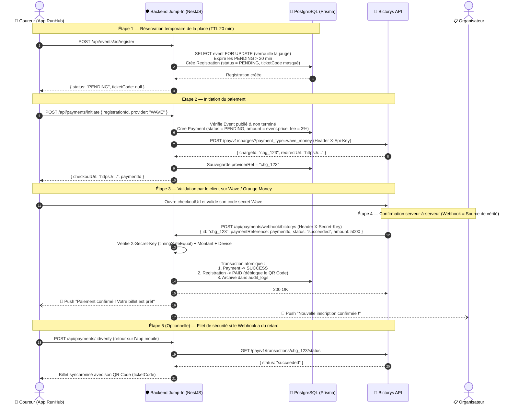

# 💳 Guide d'Ingénierie & Masterclass : Concevoir un Système de Paiement Mobile Money Robuste (NestJS, PostgreSQL & Bictorys)

> **À qui s'adresse ce guide ?**  
> Ce document a une double mission :
> 1. Servir de **documentation technique de référence** pour le module de paiement de **Jump-In / RunHub**.
> 2. Servir de **cours pratique d'ingénierie logicielle** pour tout développeur (junior, étudiant ou autodidacte) qui souhaite apprendre comment on conçoit un vrai système financier en production en Afrique de l'Ouest (**Wave, Orange Money, Free Money, Carte bancaire** via **Bictorys**) **sans perdre d'argent, sans vendre deux fois la même place et sans failles de sécurité**.

---

## Table des matières

1. [Pourquoi coder un paiement est très différent d'un CRUD classique](#1-pourquoi-coder-un-paiement-est-très-différent-dun-crud-classique)
2. [Comprendre le flux complet de bout en bout](#2-comprendre-le-flux-complet-de-bout-en-bout)
3. [Architecture SOLID du module `src/payments/`](#3-architecture-solid-du-module-srcpayments)
4. [Les 10 pièges réels en production (et comment notre code les évite)](#4-les-10-pièges-réels-en-production-et-comment-notre-code-les-évite)
5. [Guide pratique : Endpoints, variables `.env` et tests locaux avec `curl`](#5-guide-pratique--endpoints-variables-env-et-tests-locaux-avec-curl)
6. [Glossaire du développeur Fintech](#6-glossaire-du-développeur-fintech)

---

## 1. Pourquoi coder un paiement est très différent d'un CRUD classique

Quand tu codes un bouton « J'aime » ou une modification de bio sur un profil :
- Tout se passe en **une seule requête HTTP** qui dure 50 millisecondes.
- Si une erreur survient, l'utilisateur reclique et ce n'est pas grave.

Avec du **Mobile Money (Wave, Orange Money, Free Money)** ou une **carte bancaire**, le monde réel s'invite dans ton code :
1. **Le paiement est asynchrone** : ton serveur crée une demande de paiement, puis l'utilisateur quitte ton application pour aller sur Wave ou composer un code USSD `#144#`. Il peut valider **5 secondes plus tard… ou 10 minutes plus tard**.
2. **Le réseau mobile est instable** : l'utilisateur peut perdre la 4G juste après avoir payé sur Wave, avant même que l'application mobile ne se rouvre.
3. **Les utilisateurs sont humains (et impatients)** : si la page met 3 secondes à charger, ils appuient **3 fois sur « Payer »**, ou annulent leur billet puis valident quand même la notification Wave restée sur leur écran.
4. **Les serveurs externes réessaient** : si ton serveur met trop de temps à répondre à Bictorys, Bictorys pensera que tu n'as pas reçu la confirmation et te renverra **le même message (Webhook) plusieurs fois**.

> **Règle d'or en Fintech :** *Ne fais jamais confiance au téléphone du client pour te dire « J'ai payé ! » ou « Le billet coûte 5 000 FCFA ». Seul ton serveur, après confirmation signée du prestataire de paiement (PSP), a le droit de délivrer un billet.*

---

## 2. Comprendre le flux complet de bout en bout

Nous utilisons **Bictorys** comme passerelle de paiement unifiée (*Payment Service Provider* — PSP). Au lieu de coder et maintenir 4 intégrations bancaires séparées, notre backend parle un seul protocole avec Bictorys, qui route la transaction vers **Wave**, **Orange Money**, **Free Money** ou **Visa/Mastercard**.

### Diagramme de séquence complet



### Les 2 modes d'intégration Bictorys supportés

Dans `BictorysPaymentGateway` (`src/payments/providers/bictorys.gateway.ts`), nous gérons les deux modes officiels de l'API `POST /pay/v1/charges` :

| Mode | Paramètre d'URL envoyé à Bictorys | Quand l'utiliser ? | Comportement côté utilisateur |
| :--- | :--- | :--- | :--- |
| **Hosted Checkout** | Aucun (`POST /pay/v1/charges`) | Quand `useHostedCheckout: true` ou qu'aucun `provider` précis n'est forcé | Bictorys affiche sa propre page sécurisée où l'utilisateur choisit Wave, Orange Money, Free ou Carte. |
| **Direct API** | `?payment_type=wave_money` *(ou `orange_money`, `free_money`, `card`)* | Quand l'utilisateur choisit déjà « Wave » dans l'interface RunHub | Redirection directe vers l'application Wave ou déclenchement direct du flux opérateur sans étape intermédiaire. |

---

## 3. Architecture SOLID du module `src/payments/`

Au début d'un projet, on est souvent tenté de tout mettre dans un seul fichier `payments.service.ts` de 700 lignes. C'est une mauvaise pratique : le fichier devient difficile à relire, risqué à modifier et pénible à tester.

Nous avons découpé le module selon le principe **SRP (*Single Responsibility Principle* : une classe = un seul métier)** et **DIP (*Dependency Inversion Principle* : dépendre d'interfaces, pas d'implémentations concrètes)** :

```text
src/payments/
├── dto/
│   ├── initiate-payment.dto.ts         # Validation des entrées d'initiation (choix du provider à l'acte)
│   └── query-payments.dto.ts           # Pagination (?page=1&limit=20)
├── interfaces/
│   └── payment-gateway.interface.ts    # Contrat abstrait IPaymentGateway
├── providers/
│   ├── bictorys.gateway.ts             # Implémentation HTTP concrète pour Bictorys
│   └── bictorys.gateway.spec.ts        # Tests isolés des appels HTTP & signatures
├── payments.constants.ts               # Projections Prisma & fonctions pures de mapping
├── payment-notifications.service.ts    # Envoi des notifications Push/In-App (FR/EN)
├── payment-settlement.service.ts       # Moteur transactionnel atomique (Webhook & Sync)
├── payments.service.ts                 # Orchestration métier de haut niveau
├── payments.controller.ts              # Routes /api/payments/*
└── payments.module.ts                  # Assemblage NestJS (IoC)
```

### Pourquoi l'interface `IPaymentGateway` est-elle un super-pouvoir ?

Dans `payments.module.ts`, on injecte Bictorys derrière un jeton d'abstraction :

```ts
{
  provide: PAYMENT_GATEWAY,
  useClass: BictorysPaymentGateway,
}
```

**Ce que ça change concrètement :**
1. `PaymentsService` et `PaymentSettlementService` **ne savent même pas comment fonctionne `fetch()`**. Ils appellent simplement `this.paymentGateway.initiateCharge(...)`.
2. Dans les tests unitaires (`payments.service.spec.ts`), on remplace `PAYMENT_GATEWAY` par un faux objet mémoire (`mockGateway`) en 3 lignes : on peut tester des pannes, des fraudes et des doubles webhooks en millisecondes, sans connexion Internet.
3. Si demain tu veux ajouter Stripe pour l'Europe ou basculer vers un autre agrégateur, tu crées une nouvelle classe qui implémente `IPaymentGateway` sans réécrire la logique des billets.

---

## 4. Les 10 pièges réels en production (et comment notre code les évite)

Voici les erreurs les plus fréquentes chez les développeurs qui codent leur premier module de paiement, et comment chacune est résolue dans ce projet.

---

### Piège n°1 : Faire confiance au montant envoyé par l'application mobile
- **L'erreur classique :** créer un DTO `InitiatePaymentDto` avec `@IsNumber() amount: number;` et facturer ce montant. Un utilisateur malin intercepte la requête avec Postman, envoie `amount: 5` au lieu de `5000`, paie 5 FCFA et obtient son billet !
- **Notre parade (`payments.service.ts` & `payment-settlement.service.ts`) :**
  1. Le DTO **n'accepte aucun champ `amount`**. Le serveur lit `registration.event.price` dans PostgreSQL.
  2. Même au retour du Webhook Bictorys, `assertAmountAndCurrencyMatch()` vérifie que la somme encaissée est bien supérieure ou égale à `payment.amount` et dans la bonne devise (`XOF`).

---

### Piège n°2 : Vérifier le secret du Webhook avec un simple `===`
- **L'erreur classique :** n'importe qui sur Internet peut faire un `POST /api/payments/webhook/bictorys` vers ton serveur en envoyant `{ "status": "succeeded" }`. Pour prouver que l'appel vient bien de Bictorys, Bictorys envoie un en-tête secret `X-Secret-Key`. Mais comparer `secretHeader === process.env.BICTORYS_WEBHOOK_SECRET` avec `===` compare caractère par caractère et s'arrête dès la première lettre fausse (*Timing Attack*).
- **Notre parade (`bictorys.gateway.ts`) :**
  Nous utilisons `timingSafeEqual` du module natif `crypto` de Node.js, qui met exactement le même temps processeur que le secret soit presque bon ou totalement faux :
  ```ts
  const expectedBuffer = Buffer.from(this.webhookSecret.trim(), 'utf8');
  const receivedBuffer = Buffer.from(secretHeader.trim(), 'utf8');
  if (expectedBuffer.length !== receivedBuffer.length) return false;
  return timingSafeEqual(expectedBuffer, receivedBuffer);
  ```

---

### Piège n°3 : Le Rate-Limiter qui bloque ton propre partenaire bancaire (`HTTP 429`)
- **L'erreur classique :** protéger toute son API avec `@nestjs/throttler` à `5 requêtes / seconde / IP`. Pour des téléphones d'utilisateurs (qui ont chacun une IP différente), c'est parfait. Mais **les webhooks de tous tes clients viennent de la même adresse IP : celle du serveur de Bictorys !** Si 10 personnes paient pendant la même seconde, ton serveur bloque Bictorys à partir du 6e paiement avec `429 Too Many Requests` !
- **Notre parade (`payments.controller.ts`) :**
  Les routes de webhook portent `@SkipThrottle()` tout en restant verrouillées par `X-Secret-Key`.

---

### Piège n°4 : La *Race Condition* du double Webhook simultané
- **L'erreur classique :**
  ```ts
  // ❌ MAUVAIS CODE (vulnérable aux requêtes parallèles)
  const payment = await prisma.payment.findUnique({ where: { id } });
  if (payment.status === 'SUCCESS') return; // Les 2 requêtes lisent 'PENDING' en même temps !
  await prisma.payment.update({ where: { id }, data: { status: 'SUCCESS' } });
  await sendPushNotification(); // L'utilisateur reçoit 2 notifications !
  ```
- **Notre parade (`payment-settlement.service.ts`) :**
  Nous utilisons une **mise à jour conditionnelle atomique** dans PostgreSQL :
  ```ts
  // ✅ BON CODE (atomique au niveau du moteur SQL)
  const updated = await tx.payment.updateMany({
    where: {
      id: payment.id,
      status: { not: PaymentStatus.SUCCESS },
    },
    data: { status: PaymentStatus.SUCCESS },
  });

  if (updated.count === 0) {
    // Une autre requête parallèle a déjà gagné la course à la milliseconde près : on s'arrête !
    return { alreadyProcessed: true, registrationUpgraded: false };
  }
  ```
  PostgreSQL verrouille la ligne pendant l'`UPDATE` : une seule des deux requêtes obtient `count === 1`, l'autre obtient `count === 0`.

---

### Piège n°5 : La sur-réservation (*Overbooking*) après annulation + paiement tardif
- **Le scénario :** il reste **1 seule place** pour un match de Futsal (`capacity = 10`).
  1. Moussa initie un paiement Wave, puis change d'avis et clique sur « Annuler mon inscription » (`CANCELLED`).
  2. Fatou voit qu'une place est libre, s'inscrit et paie immédiatement → le match est complet (`10/10`).
  3. 3 minutes plus tard, Moussa ouvre son téléphone, voit la demande Wave toujours affichée et la valide par erreur ! Bictorys nous envoie `status: "succeeded"`.
- **Notre parade (`payment-settlement.service.ts`) :**
  Si l'inscription associée au paiement était passée en `CANCELLED`, notre transaction verrouille la ligne de l'événement (`SELECT ... FROM events WHERE id = ... FOR UPDATE`) et recompte les inscrits actifs :
  - S'il reste de la place (`activeCount < capacity`) → on réactive gentiment le billet de Moussa en `PAID`.
  - Si l'événement est complet (`10/10`) → **on ne dépasse jamais la capacité**, on marque l'alerte `refundRequired: 'event_full'` et on l'enregistre dans `audit_logs` pour rembourser Moussa proprement.

---

### Piège n°6 : Le blocage de jauge par des curieux qui ne paient jamais (*Seat Squatting*)
- **Le scénario :** un concert ou une course a 50 places payantes. 50 utilisateurs cliquent sur « S'inscrire » mais ferment l'écran de paiement sans payer. Si les inscriptions `PENDING` comptent éternellement dans la capacité, **l'événement affiche « Complet » avec 0 FCFA encaissé !**
- **Notre parade (`registrations.service.ts`) :**
  1. **Expiration automatique (Lazy TTL de 20 minutes)** : à chaque nouvelle tentative d'inscription sous verrou `FOR UPDATE`, toutes les inscriptions `PENDING` créées il y a plus de 20 minutes sans paiement réussi passent automatiquement en `CANCELLED`, libérant immédiatement les places.
  2. **Masquage du QR Code** : tant que le statut est `PENDING`, l'API renvoie `ticketCode: null`. Le QR Code n'est révélé qu'une fois le statut passé à `PAID`.
  3. **Notification organisateur au vrai paiement** : l'organisateur ne reçoit « Nouvelle inscription ! » qu'au moment où le paiement est confirmé (et non à la simple intention d'achat).

---

### Piège n°7 : La fausse notification « Paiement échoué » après un double-clic
- **Le scénario :** Awa lance un paiement (`Tentative 1`), reclique 10 secondes plus tard (`Tentative 2`), puis valide `Tentative 1` sur Orange Money. Son billet est payé ! Mais 15 minutes plus tard, `Tentative 2` (qu'elle a abandonnée) expire chez Bictorys. Bictorys envoie un webhook `expired` pour `Tentative 2`. Sans précaution, Awa reçoit une notification paniquante : *« Échec du paiement pour votre course »* alors qu'elle a déjà été débitée !
- **Notre parade (`payment-settlement.service.ts`) :**
  - Dès que `Tentative 1` réussit (`SUCCESS`), on ferme toutes les autres tentatives `PENDING` de ce billet.
  - Lorsqu'un webhook d'échec arrive, on vérifie d'abord le statut du billet (`Registration`) : s'il est déjà `PAID` ou `CHECKED_IN`, **aucune notification d'échec n'est envoyée**.

---

### Piège n°8 : Les appels HTTP sans Timeout (`AbortSignal.timeout`)
- **L'erreur classique :** appeler `await fetch(url)` sans limite de temps. Si le serveur distant met 4 minutes à répondre à cause d'une panne opérateur, ton serveur Node.js garde les promesses ouvertes en mémoire jusqu'à l'asphyxie.
- **Notre parade (`bictorys.gateway.ts`) :**
  Chaque requête vers Bictorys embarque un coupe-circuit strict :
  - `AbortSignal.timeout(12_000)` (12 secondes max) pour créer une charge.
  - `AbortSignal.timeout(8_000)` (8 secondes max) pour vérifier un statut.

---

### Piège n°9 : La faille *Open Redirect* (Hameçonnage après paiement)
- **L'erreur classique :** laisser le client choisir librement `successRedirectUrl`. Un pirate peut envoyer un lien piégé qui redirigera la victime vers `https://faux-runhub.com/reconnexion` juste après son paiement sur Bictorys.
- **Notre parade (`payments.constants.ts` → `isAllowedRedirectUrl`) :**
  Le serveur n'autorise que le schéma natif de l'application mobile (`runhub://`), `exp://` en développement, et la liste blanche stricte des domaines du projet (`https://runhub.app` et `ALLOWED_ORIGINS`). Toute autre URL est rejetée en `400 Bad Request`.

---

### Piège n°10 : Compter uniquement sur le code TypeScript sans contraintes SQL ni journal d'audit
- **Pourquoi la base de données est le dernier rempart :** même si un futur développeur modifie un service et introduit un bug, PostgreSQL doit refuser toute donnée corrompue.
- **Nos deux garanties en base (`prisma/migrations/.../migration.sql` & `audit_logs`) :**
  1. **Index uniques partiels PostgreSQL** :
     ```sql
     -- Impossible d'avoir 2 paiements 'success' pour la même inscription
     CREATE UNIQUE INDEX "payments_one_success_per_registration_idx"
     ON "payments" ("registration_id") WHERE "status" = 'success';

     -- Impossible d'avoir 2 moyens de paiement 'par défaut' pour le même utilisateur
     CREATE UNIQUE INDEX "payment_methods_one_default_per_user_idx"
     ON "payment_methods" ("user_id") WHERE "is_default" = true;
     ```
  2. **Piste d'audit (`audit_logs`)** : chaque webhook reçu écrit une trace horodatée contenant l'état avant (`before`) et le JSON brut exact envoyé par Bictorys (`after`). En cas de litige client, tu as la preuve comptable en base.

---

## 5. Guide pratique : Endpoints, variables `.env` et tests locaux avec `curl`

### 5.1 Variables d'environnement (`.env`)

```env
# Sandbox (Tests gratuits) : https://api.test.bictorys.com
# Production (Argent réel) : https://api.bictorys.com
BICTORYS_API_URL="https://api.test.bictorys.com"

# Clé publique récupérée dans Bictorys Dashboard -> Developers -> API Keys
BICTORYS_API_KEY="test_public-xxxx-xxxx.xxxx"

# Secret configuré dans Bictorys Dashboard -> Developers -> Webhooks
BICTORYS_WEBHOOK_SECRET="mon_secret_webhook_ultra_long"

# URLs de retour par défaut après paiement Hosted Checkout
BICTORYS_SUCCESS_URL="https://runhub.app/payment/success"
BICTORYS_ERROR_URL="https://runhub.app/payment/error"

# Commission prélevée par la plateforme (en %, calculée côté serveur)
PLATFORM_FEE_PERCENT=3
```

### 5.2 Tableau récapitulatif des routes API

| Méthode | Route | Auth | Rôle |
| :--- | :--- | :---: | :--- |
| `POST` | `/api/payments/initiate` | JWT | Choisit le moyen (`wave_money`, `orange_money`, `card` ou Hosted Checkout) et retourne `checkoutUrl` |
| `POST` | `/api/payments/webhook/bictorys` | `X-Secret-Key` | Reçoit la confirmation asynchrone de Bictorys et valide le billet |
| `POST` | `/api/payments/:id/verify` | JWT | Vérifie activement le statut chez Bictorys si le webhook tarde |
| `GET` | `/api/payments/mine?page=1&limit=20` | JWT | Historique paginé des paiements du coureur |
| `GET` | `/api/payments/:id` | JWT | Détail et statut d'un paiement |

### 5.3 Tester tout le cycle sur ton PC avec `curl`

#### Étape A — Initier un paiement pour une inscription `PENDING`
```bash
curl -X POST http://localhost:3000/api/payments/initiate \
  -H "Authorization: Bearer <TON_ACCESS_TOKEN_JWT>" \
  -H "Content-Type: application/json" \
  -d '{
    "registrationId": "550e8400-e29b-41d4-a716-446655440000",
    "provider": "wave_money",
    "phone": "+221770000000",
    "successRedirectUrl": "runhub://payment/success"
  }'
```

#### Étape B — Simuler l'appel Webhook de Bictorys en local
Pas besoin d'attendre un vrai paiement pour tester ta logique de validation de billet ! Tu peux jouer le rôle du serveur Bictorys avec `curl` :

```bash
curl -X POST http://localhost:3000/api/payments/webhook/bictorys \
  -H "Content-Type: application/json" \
  -H "X-Secret-Key: mon_secret_webhook_ultra_long" \
  -d '{
    "id": "chg_test_998877",
    "paymentReference": "<ID_DU_PAYMENT_RETOURNÉ_À_L_ÉTAPE_A>",
    "amount": 5000,
    "currency": "XOF",
    "paymentType": "wave_money",
    "status": "succeeded"
  }'
```
Relance exactement la même commande une deuxième fois : tu verras le serveur répondre `"processed": false, "reason": "already_succeeded"` — tu viens de vérifier l'**idempotence** en direct !

#### Étape C — Lancer la suite de tests automatisés Jest
```bash
npx jest src/payments
```

---

## 6. Glossaire du développeur Fintech

- **PSP (*Payment Service Provider*)** : Prestataire technique réglementé (comme Bictorys, Stripe, PayDunya) qui connecte ton application aux banques et aux opérateurs Mobile Money.
- **Webhook (Callback HTTP)** : Requête HTTP `POST` envoyée automatiquement par le serveur de Bictorys vers ton propre serveur pour t'annoncer un événement (« tel paiement vient de réussir »). C'est la seule source fiable car elle ne passe pas par le téléphone de l'acheteur.
- **Idempotence** : Propriété mathématique et informatique garantissant qu'exécuter **1 fois ou 10 fois** la même opération produit exactement le **même résultat final** (pas de double billet, pas de double notification, pas de double écriture comptable).
- **Transaction ACID (`prisma.$transaction`)** : Groupe d'opérations SQL qui réussissent **toutes ensemble** ou échouent **toutes ensemble** (*Tout ou Rien*). Il est ainsi impossible d'avoir un `Payment` en `SUCCESS` alors que la `Registration` est restée bloquée en `PENDING` suite à une coupure serveur.
- **Verrou pessimiste (`SELECT ... FOR UPDATE`)** : Instruction PostgreSQL qui pose un cadenas temporaire sur une ligne précise (par exemple un événement) le temps d'une transaction. Si 50 personnes achètent la dernière place à la même milliseconde, PostgreSQL les fait passer à la queue leu leu en quelques microsecondes : 1 seule obtient la place, les 49 autres reçoivent « Complet ».
- **TTL (*Time-To-Live*)** : Durée de vie maximale d'une réservation non payée (ici 20 minutes) avant qu'elle ne soit automatiquement libérée pour les autres utilisateurs.
